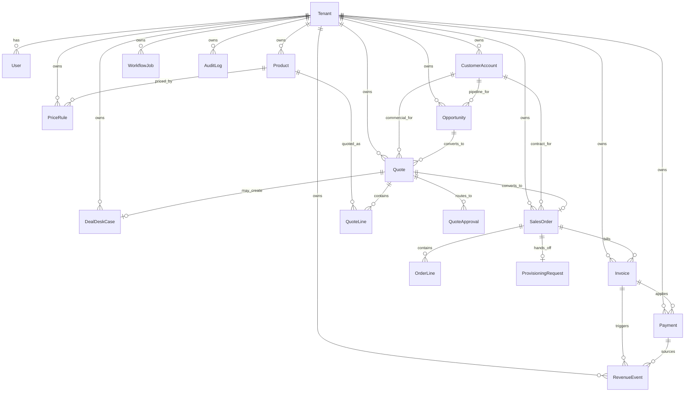

# Domain Model

Entities and ownership:

- `Tenant`
  Schema: `prisma/schema.prisma` model `Tenant`
  Primary service owner: tenant scope is enforced from `src/lib/auth/session.ts` and then consumed across all service files
- `CustomerAccount`
  Schema: `prisma/schema.prisma` model `CustomerAccount`
  Primary service owner: `src/services/opportunity-service.ts` and `src/services/quote-service.ts`
- `Product`
  Schema: `prisma/schema.prisma` model `Product`
  Primary service owner: `src/services/catalog-service.ts`
- `PriceRule`
  Schema: `prisma/schema.prisma` model `PriceRule`
  Primary service owner: `src/services/catalog-service.ts`
- `Opportunity`
  Schema: `prisma/schema.prisma` model `Opportunity`
  Primary service owner: `src/services/opportunity-service.ts`
- `Quote`
  Schema: `prisma/schema.prisma` model `Quote`
  Primary service owner: `src/services/quote-service.ts`
- `QuoteLine`
  Schema: `prisma/schema.prisma` model `QuoteLine`
  Primary service owner: `src/services/quote-service.ts`
- `QuoteApproval`
  Schema: `prisma/schema.prisma` model `QuoteApproval`
  Primary service owner: `src/services/quote-service.ts`
- `DealDeskCase`
  Schema: `prisma/schema.prisma` model `DealDeskCase`
  Primary service owner: `src/services/quote-service.ts`
- `SalesOrder`
  Schema: `prisma/schema.prisma` model `SalesOrder`
  Primary service owner: `src/services/order-service.ts`
- `OrderLine`
  Schema: `prisma/schema.prisma` model `OrderLine`
  Primary service owner: `src/services/order-service.ts`
- `ProvisioningRequest`
  Schema: `prisma/schema.prisma` model `ProvisioningRequest`
  Primary service owner: `src/services/order-service.ts`
- `Invoice`
  Schema: `prisma/schema.prisma` model `Invoice`
  Primary service owner: `src/services/invoice-service.ts`
- `Payment`
  Schema: `prisma/schema.prisma` model `Payment`
  Primary service owner: `src/services/invoice-service.ts`
- `RevenueEvent`
  Schema: `prisma/schema.prisma` model `RevenueEvent`
  Primary service owner: `src/services/invoice-service.ts`
- `WorkflowJob`
  Schema: `prisma/schema.prisma` model `WorkflowJob`
  Primary service owner: enqueue points live in `src/services/order-service.ts` and `src/services/invoice-service.ts`
- `AuditLog`
  Schema: `prisma/schema.prisma` model `AuditLog`
  Primary service owner: called from `src/services/catalog-service.ts`, `src/services/opportunity-service.ts`, `src/services/quote-service.ts`, `src/services/order-service.ts`, and `src/services/invoice-service.ts`
